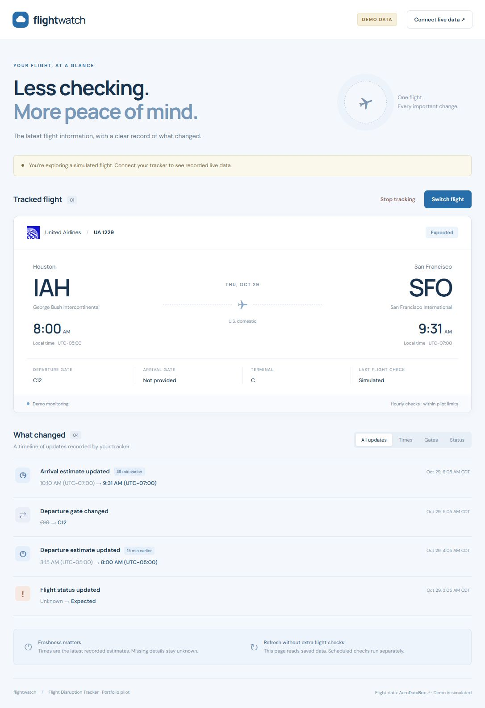
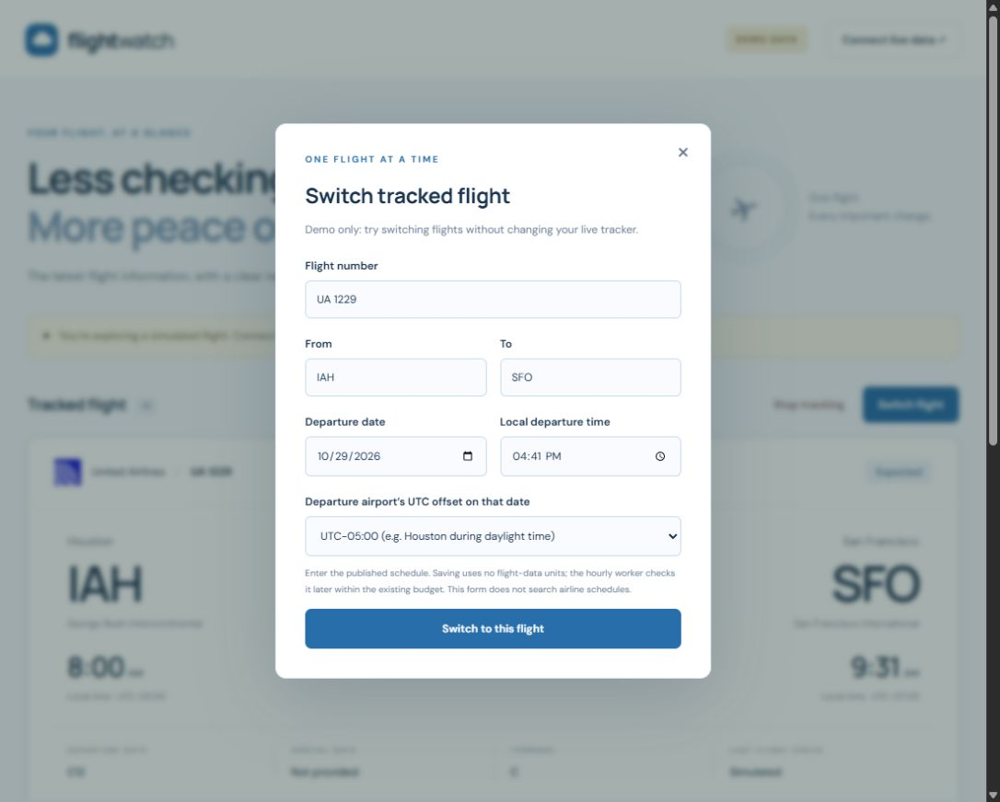
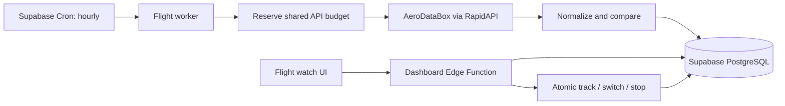

# Flight watch

A flight disruption tracker that checks a flight in the background, records what changed, and surfaces updates in a web dashboard.

A backend-focused portfolio project covering external APIs, scheduled processing, PostgreSQL transactions, change detection, idempotency, concurrency controls, and conservative usage budgets. The interface uses blue branding and a cloud mark. Updates appear in the dashboard; email notifications are not part of the current product.



**The screenshots and built-in United Airlines UA1229 example are simulated.** They do not assert a current flight schedule or disruption. This independent project is not affiliated with United Airlines.

## Features

- One tracked U.S. domestic flight per pilot deployment.
- Track, switch, and stop flights from the interface.
- Flight status, route, gates, terminals, revised estimates, and data freshness.
- A timeline of time, gate, terminal, cancellation, and status changes, with category filters.
- Hourly background checks that run while the user's computer is off.
- Separate tokens for reading data and controlling flights; provider and database keys stay out of browser code.
- A locally bundled United globe icon for United; other carriers use their own airline-code badge. The badge changes with the enrolled airline and has a neutral fallback for unknown carriers.
- An offline demo requiring no API accounts or flight-data requests.



## Quick start: local demo

Requirements: **Node.js 22+** and Git. API accounts are not required for demo mode.

```sh
git clone https://github.com/Sonderence/flight-watch.git
cd flight-watch
npm ci
npm run ui
```

Open **http://127.0.0.1:4173**. Keep the terminal open; Ctrl+C stops the local server. The page starts in **Demo data** mode. Demo flight controls do not change live tracking.

On Windows PowerShell use `npm.cmd` instead of `npm` if execution policy blocks npm scripts. If the port is occupied, run `npm run ui -- 4174` and open the printed address.

```sh
npm test
```

Tests use mocked HTTP requests and a local PostgreSQL engine, [PGlite](https://github.com/electric-sql/pglite). They make no live provider calls, send no email, and consume no flight API units. PGlite is a development dependency; runtime code has no npm dependencies.

## Architecture



The worker reserves quota **before** a request, matches returned flights to the enrolled number/date/route, normalizes the response, and compares it to the previous baseline. It saves the observation, change events, and next baseline in one transaction. Version checks prevent competing writes; observation IDs make repeated saves idempotent; stale observations are rejected.

Missing provider fields do not count as changes. Previously known comparison values are kept separate from the latest observation displayed in the UI, so old data is not presented as fresh.

**Opening or refreshing the dashboard never calls AeroDataBox.** Enrollment and flight switching only update the database. The next eligible scheduled run performs the lookup. Switching does not reset usage counters.

## Free-tier safeguards

| Control | Application limit |
| --- | --- |
| Active flights | 1 globally |
| Enrollment window | Departure within the next 24 hours |
| Monitoring window | 6 hours before departure through 6 hours after |
| Minimum polling spacing | 1 hour |
| Shared rolling daily budget | 4 attempts per 24 hours |
| Shared rolling quota | 80 units per 35 days; 40 ordinary 2-unit status attempts |
| Per-enrollment cap | 12 attempts, subject to shared budgets |
| Local lookup experiment | Separate lifetime 20-unit cap |
| Provider error behavior | No immediate retry; pilot stops for review |
| Flight-plan add-on | Disabled |

Failed requests and crashes retain their reservations. Four daily attempts may stop checks before departure: this is a conservative pilot, not continuous minute-by-minute monitoring.

These safeguards are not a guarantee about third-party pricing. Provider-console requests and other applications are outside the app's ledger. Verify the current [AeroDataBox plan](https://rapidapi.com/aedbx-aedbx/api/aerodatabox/pricing), [Supabase pricing](https://supabase.com/pricing), usage terms, and billing controls before live use. Stay on free plans and do not enable paid add-ons. Free hosting may pause or have other usage limits.

## Live setup

### 1. Accounts

Create a dedicated project in a **Free Supabase organization** at the [Supabase dashboard](https://supabase.com/dashboard). Subscribe to **AeroDataBox Basic $0 inside RapidAPI**, after checking current terms and limits. A RapidAPI account alone is not an AeroDataBox subscription.

Keep RapidAPI and backend Supabase keys private. Never place them in browser code, screenshots, Git commits, or issues.

### 2. Database

Run these files **once each, in order**, in the Supabase SQL Editor:

1. [001_flight_storage.sql](supabase/migrations/001_flight_storage.sql)
2. [002_scheduled_worker.sql](supabase/migrations/002_scheduled_worker.sql)
3. [004_dashboard_controls.sql](supabase/migrations/004_dashboard_controls.sql)

**Skip migration 003**, which belongs to an abandoned email experiment. Do not rerun earlier migrations on an existing installation.

Enable Cron (`pg_cron`) under Supabase Integrations. Enable networking in SQL Editor:

```sql
create extension if not exists pg_net with schema extensions;
```

Schedule daily cleanup:

```sql
select cron.schedule(
  'purge-expired-flight-data', '0 0 * * *',
  'select public.purge_expired_flight_data();'
);
```

Tables use Row Level Security and deny direct access to anonymous/ordinary browser users. Do not disable table security to connect the UI.

### 3. Backend secrets

Under **Edge Functions → Secrets**, add:

| Name | Value |
| --- | --- |
| `RAPIDAPI_KEY` | AeroDataBox RapidAPI key |
| `WORKER_DB_SECRET` | Supabase backend secret key beginning `sb_secret_` |
| `WORKER_CRON_SECRET` | New random worker request secret |
| `WORKER_LIVE_ENABLED` | `false` while setting up |
| `DASHBOARD_READ_TOKEN` | Separate random read token |
| `DASHBOARD_MANAGE_TOKEN` | Separate random control token |
| `DASHBOARD_ENABLED` | `true` |
| `DASHBOARD_MANAGEMENT_ENABLED` | `true` |

Generate a different 64-character secret for each of the three token purposes:

```sh
node -e "console.log(require('node:crypto').randomBytes(32).toString('hex'))"
```

Paste values without quotes or extra spaces. Supabase supplies `SUPABASE_URL` automatically to deployed functions. The UI receives only its dedicated read/control tokens, never the backend secret or RapidAPI key.

### 4. Edge Functions

Create two functions using **Edge Functions → Deploy a new function → Via Editor**:

| Function name | Copy the complete generated file |
| --- | --- |
| `flight-worker` | [flight-worker/index.ts](supabase/functions/flight-worker/index.ts) |
| `flight-dashboard` | [flight-dashboard/index.ts](supabase/functions/flight-dashboard/index.ts) |

Deploy both. Turn OFF platform **Verify JWT / Enforce JWT verification** for these functions: their handlers check dedicated headers instead. The worker requires `x-worker-secret`; dashboard reads require `x-dashboard-token`; writes require `x-dashboard-manage-token`. Missing/incorrect tokens are rejected. Do not deploy the legacy email worker.

After editing source modules, regenerate and redeploy the affected bundle:

```sh
npm run build:worker
npm run build:dashboard
```

The worker build also emits an unused legacy email bundle; it is not part of this setup.

### 5. Scheduled checks

In **Integrations → Vault**, create these exact names:

| Vault name | Value |
| --- | --- |
| `flight_worker_url` | `https://YOUR-PROJECT.supabase.co/functions/v1/flight-worker` |
| `flight_worker_cron_secret` | Exactly the same value as `WORKER_CRON_SECRET` |

Copy the worker's endpoint URL, not its dashboard page URL. Secret names must not include quotes or apostrophes.

Run [supabase/worker-cron.sql](supabase/worker-cron.sql). It creates an hourly job at minute 0 and performs cleanup before invoking the worker. Keep the daily cleanup as a fallback.

Test the worker's OFF state first: in its Test panel send POST body `{}` and header `x-worker-secret` with the worker secret. Expected: `{"result":"disabled"}`. This uses no flight API units.

### 6. Connect the interface

Open the local UI and click **Connect live data**:

- Endpoint: `https://YOUR-PROJECT.supabase.co/functions/v1/flight-dashboard`.
- Read token: `DASHBOARD_READ_TOKEN`.
- Flight control token: `DASHBOARD_MANAGE_TOKEN` (optional for viewing).

Click **Connect tracker**. Tokens are kept only in the browser-tab session. Read tokens are not accepted for flight changes. The existing hosted portfolio page is owner-private; cloning the repository and running the demo is the reproducible option for other readers.

The files in `web/dist/` can also be served by a static hosting provider. Observe that provider's free limits. No particular paid host or custom domain is required by this project.

### 7. Enroll and activate

Use **Track a flight** or **Switch flight**. Enter a real U.S. domestic flight number, route, departure date/time and the departure airport's UTC offset on that date. **UA1229** is an example of a United identifier; demo times are not a current schedule.

The form does not search airline schedules. Departures must be within 24 hours. Saving uses no flight API units. Replacing a flight clears its live records but preserves all budget reservations.

Enable both switches separately:

1. Change function secret `WORKER_LIVE_ENABLED` to `true`.
2. Run:

```sql
update public.worker_settings set enabled=true where singleton=true;
```

The next hourly run checks an eligible flight if budget remains. The first observation is a baseline; later changes appear in the timeline. Opening or refreshing the UI does not request additional provider checks.

### 8. Verify

Inspect **Cron → Jobs → History**, function logs, and `worker_attempts`. Cron success means the HTTP request was queued; check the response to confirm function execution:

```sql
select created,status_code,error_msg,content
from net._http_response order by created desc limit 5;
```

| Result | Check |
| --- | --- |
| `schema "net" does not exist` | Enable `pg_net` |
| 404 | Fix the worker endpoint URL in Vault |
| Missing authorization header | Turn off platform JWT verification for this custom-auth handler |
| `Unauthorized` | Exact Vault name and matching worker secret |
| `idle` | No active flight, outside monitoring window, or not yet due |
| `saved` | Observation stored successfully |
| `daily_limit` / `budget_exhausted` | Shared budget is stopping provider calls as intended |
| Flight controls return 401 | Use the management token, not the read token |
| Controls return 409 | Refresh: another session changed the enrollment |
| Controls return 502 | Check migration 004 and the updated dashboard bundle; refresh before retrying |

Read the budget without a provider request:

```sql
select coalesce(sum(units),0) as reserved_units,
       80-coalesce(sum(units),0) as units_remaining
from public.worker_attempts
where reserved_at>=now()-interval '35 days';
```

**Stop tracking** ends the pilot and clears its live contents. To pause all provider requests, set `WORKER_LIVE_ENABLED=false` or `worker_settings.enabled=false`. Leave cleanup jobs enabled. An already running request cannot be recalled.

## Optional local experiments

Copy `.env.example` to `.env` (`cp .env.example .env`, or `Copy-Item .env.example .env` in PowerShell). It is ignored by Git. Local settings are not automatically uploaded to Supabase functions.

| Command | Behavior |
| --- | --- |
| `npm run demo` | Offline normalized-flight fixture |
| `npm run changes` | Offline delay/gate/cancellation comparison |
| `npm run db:demo -- baseline` | Save a synthetic baseline |
| `npm run db:demo -- delay` | Save a synthetic delay |
| `npm run db:demo -- cancel` | Save a synthetic cancellation |
| `npm run lookup -- UA1229 YYYY-MM-DD --live` | One live lookup; substitute a real date and verified flight |
| `npm run track -- UA1229 YYYY-MM-DD IAH SFO YYYY-MM-DDT08:00:00-05:00` | Terminal enrollment using actual schedule values |

Live lookup needs `RAPIDAPI_KEY` and `LIVE_LOOKUP_ENABLED=true`. Synthetic database commands need `SUPABASE_URL` and `SUPABASE_SECRET_KEY`.

## Structure

```text
web/dist/                   Dashboard, airline badges, local United icon
src/                        Provider adapter, comparison, storage and handlers
supabase/migrations/        Schema and transactional functions
supabase/functions/         Generated Edge Function bundles
supabase/worker-cron.sql    Hourly scheduler using Vault and pg_net
scripts/                    Local server and bundle generation
test/                       Mocked integration and PostgreSQL safety tests
fixtures/                   Synthetic offline data
docs/screenshots/           Simulated United example screenshots
```

The `email*` files and migration 003 are retained from an earlier experiment, disabled by default, and outside the current product. Do not deploy/enable them for this setup.

## Limitations

- Single-flight operator pilot, not a public multi-user service. Public access would need per-user authentication and authorization.
- Provider coverage, gates and estimates can be missing, incomplete or delayed. Revised times are estimates, not proof of takeoff or landing.
- No email notifications, airline schedule search, or permanent trip archive.
- Live records are deleted when monitoring ends. Six-day expiry plus cleanup limits other cached contents; cleanup job failures need attention.
- No automatic reconciliation when a flight moves to another departure date.
- Free infrastructure is best-effort and shares account-level usage limits.

## Credits

Live data: [AeroDataBox](https://aerodatabox.com), through RapidAPI. Follow the applicable noncommercial-use, attribution and retention terms. No real provider responses or credentials appear in screenshots or demo fixtures.

The United icon is bundled for identification. Airline names/logos remain the property of their owners; see [third-party notices](THIRD-PARTY-NOTICES.md). Other airlines use explicit code badges rather than a mismatched logo.

Built incrementally with AI assistance, with live integration checks and automated tests for backend behavior and failure scenarios.
